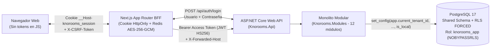

# Arquitectura General y Límites de Módulos de KNOROOMS

## 1. Visión Arquitectónica

**KNOROOMS** está construido como un **monolito modular** sobre **ASP.NET Core (.NET 10 LTS)**, **Entity Framework Core 10**, **PostgreSQL 17 (con Row-Level Security)** y **Next.js (App Router) como Backend for Frontend (BFF)**.

- **Sin microservicios prematuros**: un único despliegue de API y un único `ApplicationDbContext` compartido reducen la complejidad operativa inicial sin sacrificar el aislamiento entre dominios.
- **Pocos proyectos `.csproj`**: la solución `backend/Knorooms.slnx` mantiene únicamente 3 proyectos de código (`Knorooms.SharedKernel`, `Knorooms.Modules`, `Knorooms.Api`) y 2 proyectos de pruebas (`Knorooms.UnitTests`, `Knorooms.IntegrationTests`).
- **Encapsulamiento estricto verificable**: las clases de `Application` e `Infrastructure` de cada módulo son `internal` y se validan automáticamente con **NetArchTest** para impedir acoplamientos cruzados entre módulos.

Los JWT y refresh tokens son emitidos por el propio backend de KNOROOMS (no hay proveedor de identidad externo). Ver `docs/decisions/0004-local-credentials-and-backend-issued-jwt.md`.

---

## 2. Los 12 Módulos actuales del Backend (`Knorooms.Modules`)

| # | Módulo | Ámbito | Responsabilidad principal | Estado observado en código |
|---|---|---|---|---|
| 1 | `Tenants` | Global / Tenant | Registro de instituciones educativas (`Institution`), estado (`Active`/`Suspended`), resolución por `Slug`. | Implementado; no revalidado end-to-end en esta revisión |
| 2 | `Identity` | Global | Cuentas con credenciales locales (`UserAccount`), hash PBKDF2, emisión de JWT propios y refresh tokens opacos con rotación, bloqueo por intentos fallidos y revocación global de sesiones (`SessionRevokedBeforeUtc`). | Implementado; no revalidado end-to-end en esta revisión |
| 3 | `Platform` | Global | Administración SaaS (`IPlatformInstitutionService`), alta de colegios, asignación de administrador inicial y `OutboxMessage` (Transactional Outbox). | Implementado; no revalidado end-to-end en esta revisión |
| 4 | `Authorization` | Global / Tenant | Catálogo central de permisos (`PermissionCatalog`), roles por colegio (`InstitutionRole`), membresías (`TenantMembership`) y evaluación RBAC + ABAC. | Implementado; no revalidado end-to-end en esta revisión |
| 5 | `SupportAccess` | Global / Tenant | Solicitud, aprobación institucional, expiración temporal y revocación inmediata de acceso de soporte (`SupportAccessGrant`). | Implementado; no revalidado end-to-end en esta revisión |
| 6 | `Audit` | Global / Tenant | Bitácora inmutable (`AuditLogEntry`) con sanitización automática de claves sensibles. | Implementado; no revalidado en esta revisión |
| 7 | `Students` | Tenant | Expediente permanente del estudiante (`StudentRecord`), responsables (`Guardian`) y vínculos granulares (`StudentGuardianLink`). | Dominio, servicios y API implementados; validación funcional pendiente |
| 8 | `Academic` | Tenant | Años escolares (`AcademicYear`), niveles/grados (`GradeLevel`), secciones (`SchoolSection`), asignaturas (`Subject`) y asignaciones docentes (`TeacherAssignment`). | Dominio, servicios y API implementados; validación funcional pendiente |
| 9 | `Enrollments` | Tenant | Matrículas por año escolar (`StudentEnrollment`) sin duplicar el expediente del estudiante. | Dominio, servicios y API implementados; validación funcional pendiente |
| 10 | `Attendance` | Tenant | Registro de asistencia diaria/por sección (`AttendanceRecord`: presente, ausente, tardanza, justificado). | Dominio, servicios y API implementados; validación funcional pendiente |
| 11 | `Grading` | Tenant | Políticas de evaluación versionadas (`EvaluationPolicyVersion`) y calificaciones (`GradeEntry`) con separación de funciones. | Dominio, servicios y API implementados; validación funcional pendiente |
| 12 | `ReportCards` | Tenant | Instantáneas históricas inmutables de boletines publicados (`ReportCardSnapshot`) y rectificaciones auditadas. | Dominio, servicios y API implementados; validación funcional pendiente |

---

## 3. Reglas de Comunicación entre Módulos

1. **Operaciones síncronas**: un módulo o controlador consume únicamente tipos públicos del espacio de nombres `Knorooms.Modules.Modules.<Modulo>.Contracts` (interfaces y DTOs).
2. **Prohibido referenciar `Application` o `Infrastructure` ajenos**: validado en cada ejecución de `dotnet test` mediante `ModularMonolithArchitectureTests`.
3. **Consecuencias desacopladas y entrega confiable**: las entidades registran eventos de dominio (`IDomainEvent`) que `ApplicationDbContext.SaveChangesAsync` convierte atómicamente en registros `OutboxMessage` dentro de la misma transacción PostgreSQL antes del `COMMIT`. `OutboxProcessorHostedService` los procesa posteriormente.

## 4. Evolución acordada: SaaS escolar y Moodle
Los 12 módulos anteriores describen el código actual, no el alcance completo del producto ni un límite al número de módulos. La revisión documental no ejecutó pruebas funcionales. En evaluación y boletines existen hallazgos pendientes de corregir antes del piloto.

La arquitectura objetivo incorpora Subscriptions, Entitlements e Integrations dentro de Knorooms.Modules, sin nuevos despliegues ni proyectos por módulo. Platform coordina la ficha del colegio; Academic es responsable de la carga académica; Integrations importa mediante contratos sin publicar notas oficiales.

- [Alcance escolar vigente](../product/scope.md).
- [Responsabilidades y seguridad SaaS/Moodle](saas-administration-and-moodle.md).
- [Secuencia y correcciones necesarias](../product/implementation-roadmap.md).
- [Decisión ADR-0005](../decisions/0005-school-saas-and-moodle-scope.md).

Moodle puede estar deshabilitado para un colegio sin impedir la operación manual. Suscripciones y derechos comerciales se validan además de permisos y RLS. Educación superior queda fuera del alcance inicial.
